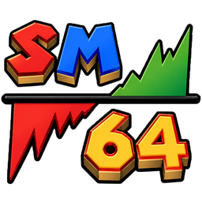
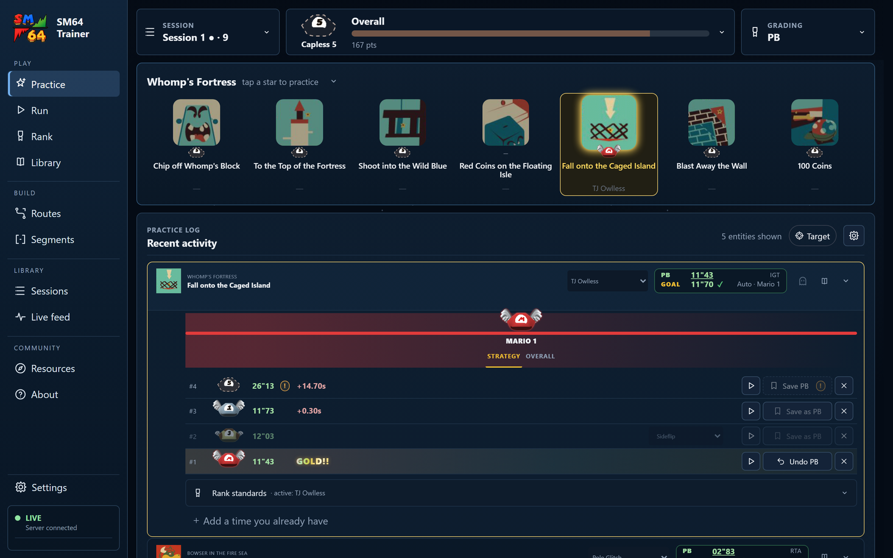
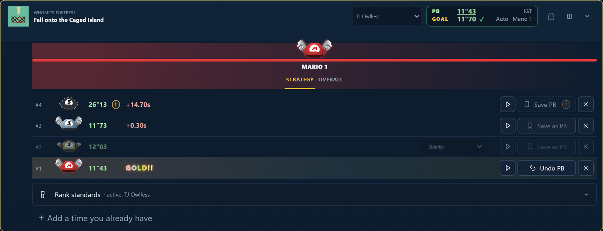
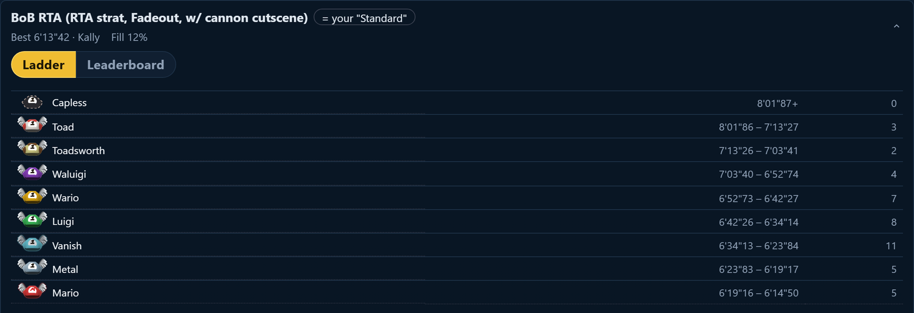
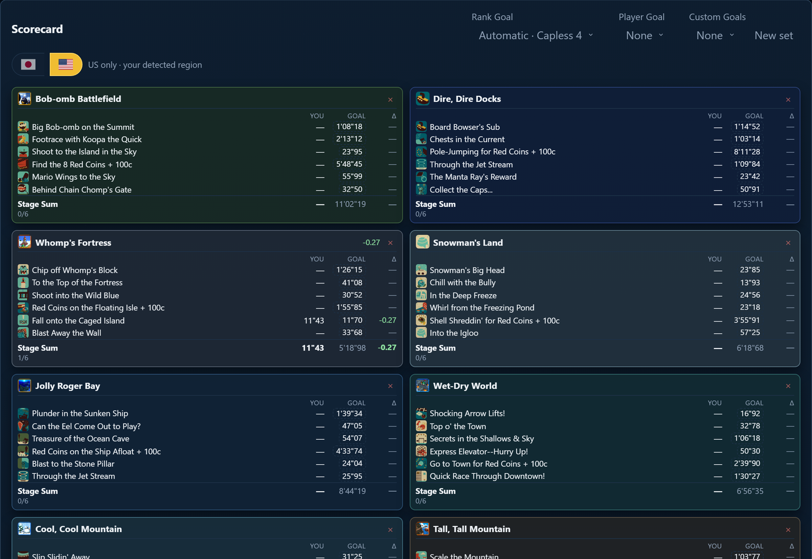
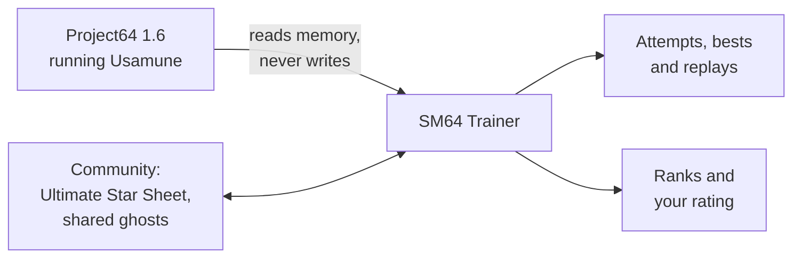

<!-- Keep this page about outcomes, not controls: say what a player gets
     ("every attempt is timed"), never which button to press, so a redesign
     changes a picture rather than a paragraph. The screenshots in
     docs/readme/ regenerate with `uv run python tools/readme_media.py`
     (CONTRIBUTING.md). Feature detail belongs in docs/user-guide.md. -->

<div align="center">



# SM64 Trainer

**Make every attempt count: the free Super Mario 64 practice companion for Usamune and Project64.**

Play the way you already do. The trainer times every attempt, keeps your
bests and their replays, and shows you exactly how your practice is paying off.

[](https://sm64trainer.app)

[Website](https://sm64trainer.app) · [All releases](https://github.com/griffinbeels/SM64-Trainer/releases) · [User guide](docs/user-guide.md) · [Contributing](CONTRIBUTING.md) · [Support (optional)](https://ko-fi.com/sm64trainer)

[](https://github.com/griffinbeels/SM64-Trainer/releases)
[](LICENSE)




</div>

## What you get

**You do the practicing. The trainer keeps score.** No spreadsheet to fill
in, no splits to set up, no new ROM to learn. Open the trainer, open
Project64, and play Usamune the way you always have.

### Every attempt, timed and kept

Star grabs, resets and deaths are recorded the moment they happen, timed by
Usamune's own clock. Eligible new bests become **GOLDs**: they save their
replay and show exactly how much time you just found.



### See what your hands did

Watch any attempt back the moment it ends, alongside its controller inputs.
Compare it with a saved run and spot the difference.

### Race the community, inside the game

Challenge a shared ghost directly in Project64. See someone else's line, try
to keep up, and turn a time on a spreadsheet into something you can learn
from. Your best attempt could be someone else's next breakthrough.

### A clear ladder, from Capless to Mario

Community time standards turn improvement into a rank you can see. Ranks are
graded per strategy, so a fast time on one never flatters another. Nine tiers
of five divisions give every star a next goal, and one rating rolls them all up.



### Learn from everyone's best runs

The community's Ultimate Star Sheet lives inside the app: every star's
strategies and recorded runs, filed by the rank they would earn you, with
their videos playing in place. Bring your Sheet times in, and copy your new
bests back out.

### See the whole game at a glance

Pick a goal and the scorecard lines every star up against it, course by
course, so you know where your next minute is hiding.



**And more:** practice any trick as its own segment, build routes and run
them as a forgiving full-game RTA with live splits, and look back over every
session. The app keeps itself up to date, downloading only what changed.

## Get started

1. **Download** `SM64Trainer.exe` from [sm64trainer.app](https://sm64trainer.app)
   and run it. The installer is unsigned, so Windows SmartScreen warns: choose
   **More info → Run anyway**. It installs to `%LOCALAPPDATA%\Programs\SM64Trainer`
   and adds a Desktop shortcut.
2. **Sign in**, so the ghosts you share carry your name.
3. **Set up Project64.** The wizard finds Project64 1.6, installs the replay
   capture plugin, and checks the game, pictures and inputs with you.
4. **Go practice.** Open Usamune, pick a star, and chase your next GOLD.

<details>
<summary><b>What you need</b></summary>

- Windows 11, or Windows 10 with the
  [WebView2 runtime](https://developer.microsoft.com/microsoft-edge/webview2/).
- **Project64 1.6**, running windowed.
- Your own **Usamune v1.93u (US)** or v1.93j (JP) practice ROM. ROMs are not
  included.
- Frame-matched replays need an NVIDIA graphics card. Other cards record
  replays without the frame-by-frame input match.

Prefer a portable copy? Download `SM64Trainer-full.zip` from the releases
page, extract it anywhere and run the exe inside. Your history lives in
`%LOCALAPPDATA%\SM64Trainer` and survives every update.

</details>

## How it works



The trainer reads Super Mario 64's memory from Project64 many times a second,
the way tools like STROOP do, and never writes to it, so your game plays
exactly as before. It recognizes star grabs, resets and deaths as they happen,
times them with Usamune's own clock, and keeps everything on your PC. A
graphics plugin records the game window for replays and draws the ghosts. In
the app, **About → How it works** walks through each step.

<details>
<summary><b>Questions</b></summary>

**Is it safe to install?** It is open source, every release comes with SHA-256
checksums, and the app verifies each update before applying it. The installer
is unsigned, which is why SmartScreen warns.

**Will it change my game or my setup?** It only reads the game's memory. The
replay plugin leaves your previous graphics plugin installed, and the setup
screen switches back to it. Outside the Usamune practice ROM, nothing is
tracked or recorded.

**What gets shared?** A ghost shares Mario's poses, timing and optionally
your inputs, with your display name. Never your ROM, videos or practice
history. You can stop future uploads in Settings, and withdraw the ghosts you
already shared.

**Is it really free?** Yes, always. There are no paid ranks or features.

</details>

## Contributing

Bug reports, ideas and pull requests are welcome. To run it from source on
Windows with [uv](https://docs.astral.sh/uv/):

```
git clone https://github.com/griffinbeels/SM64-Trainer.git
cd SM64-Trainer
uv sync
uv run python -m sm64_events.desktop
```

[CONTRIBUTING.md](CONTRIBUTING.md) covers tests, builds and releases, and how
the codebase is organized for AI coding agents. The [user guide](docs/user-guide.md)
documents every feature in detail, and [docs/architecture.md](docs/architecture.md)
explains how the game is read.

## Credits and license

SM64 Trainer stands on the work of the Super Mario 64 community: Usamune, the
SM64 decompilation, STROOP, libsm64, the Ultimate Star Sheet, Ukikipedia and
many more. **About → Credits** in the app names everyone.

Free software under [GPL-3.0-or-later](LICENSE). Fork it, build on it, learn
from it; if you distribute it or anything made from it, keep it open source
under the same license. Third-party licenses are listed in
[licenses/](licenses/README.md).

<sub>An independent community project, not affiliated with Nintendo.</sub>
