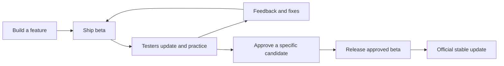

# Beta-to-production pipeline

Status: single-install beta/production updates implemented. Round 51 adds public
beta distribution for streamer viewers. Open beta enrollment was chosen on
October 15, 2026; exact-candidate gameplay acceptance and publication remain
separate operator gates.
Implementation approval: event:042e8c5a19555fd43c256bfb8a1b9835693f103b3cd724bee09f184965c184a7.
Current human source: event:7c38b72652f2f19bd8ba8e0c7671f43354b12f55e365dfcd26c52fd5507f906c.
This supersedes the two-installation Round32 proposal, whose original source
remains in the private round ledger.
Open enrollment source: event:7f9bb6da0c489b8e78dcc04236fb684f19cb3e7e0e9d6b0d1cb96cdd0bbd4268.

## The repeatable loop

Keep **one installation, shortcut, account and local profile**. Add a Settings
toggle, **Receive beta updates**. A production build leaves it off; a beta
build turns it on once, the first time it opens, unless the player already
chose (`core/update_policy.py::adopt_channel_default`, which records who chose
in `beta_choice`). A tester installed from a beta therefore receives every
published beta and, later, production, in the same installation. Beta and
Stable identify release types, not different installed programs or data
directories. Add a thin
release coordinator over the existing packaging and release tools. Its two
operator actions are **Ship beta** and **Release approved beta**, implemented
by `tools/release_flow.py` over the shared `tools/release.py` phases.



Use short feature branches and immutable candidate records. A separate long-lived
beta branch would add another place for fixes to drift. A candidate records its
source revision, dependency lock, native DLL hashes, packaged artifacts, cloud
code/catalog/migration versions, public configuration fingerprint, checks and
feedback. Private capabilities and credentials never enter this record.

All users install the normal GitHub application. Enabling beta immediately checks
for the newest eligible update and offers the same existing update popup.
Launch/account sign-in schedules the normal cached check; sign-in is not required
to update a publicly released application. Disabling beta stops new beta offers
without reinstalling, resetting data or downgrading the installed application.

Startup gives the update check and any available offer priority over sign-in,
signup and emulator setup. A failed check or five-second wait releases onboarding;
a late offer preserves any unfinished form, sign-in attempt and setup state.
Later and Skip release onboarding immediately. Existing published clients retain
their own check schedule: older normal betas check on launch or manually, rather
than continuously while already open. No sign-in is needed to download or apply
an update; the existing live-practice safety guards still govern application.

Updates download changed files where practical and apply when the player
chooses to restart at a safe idle point. They never interrupt a live attempt,
recording or emulator plugin installation. If bundled emulator plugins change,
finish their guarded upgrade with Project64 closed before using the new
client/native pair. Offline users keep practicing.

Use the existing updater interaction. There is no channel picker, second installer
or beta-only account onboarding in the eventual public application.

## Public beta distribution

The streamer-facing entry point is `/beta/` on the existing website. Reuse the
same page design and assets, identify the download as a beta, and display its
version. The address stays constant as newer public betas are published. A public
prerelease does not require a production release first; preserve the stable
website's community-version floor rather than advertising an old stable build
as community-enabled. Website selection and publishing belong to
[the website runbook](website-deployment.md).

The public beta installer must carry its beta installation intent from the
build, not infer it from its filename or depend on a pre-existing profile's beta
preference. Test the actual installation flow with a fresh profile before linking
it. After installation, the normal beta default and saved player preference govern
future update offers. An existing newer installation must never be downgraded.

Public candidates contain no friend invitation. When the community service's
explicit public-signup setting is enabled, viewers authenticate and complete the
normal name and policy-consent flow without an invitation. Existing account
restrictions and resource budgets still apply; see
[the community protocol](community-protocol.md). Private tester candidates remain
private and frozen. Changing a link does not establish that installation, account
entry or update delivery works: verify those boundaries before the streamer shares
the address.

## Implemented responsibilities

| Responsibility | Owning implementation | Round34 behavior |
|---|---|---|
| Build beta | `tools/release_flow.py`, `tools/release.py`, `tools/build_beta.py` | New normal-identity payloads with immutable receipts; retain the legacy isolated builder |
| Build application | `tools/build_exe.py` | Complete essential payload, staged runtime version, exact manifest binding and source recheck |
| Incremental update | `core/updater.py`, `core/update_plan.py`, `core/update_apply.py`, `core/release_contract.py` | Shared prerelease ordering, eligible selection, default-off beta setting, safe application and forward floor |
| Publish release | `tools/release.py`, `tools/release_lineage.py` | Explicit draft/publish phases, six downloaded asset digests, resolved tag ancestry and profile QA |
| Verify source | Local merge check and GitHub `full.yml` | Exact candidate source plus immutable frozen checks and human acceptance |
| Cloud release | Worker, D1 migrations, R2, managed Auth and catalog | Separate operator rollout; bounded public revision fingerprints in candidate receipts |

Before Round34, legacy beta update checks were disabled, stable metadata rejected
community fields, and beta OAuth was tied to 8072. New schema2 builds explicitly
declare `installation="normal"`: stable and beta share the normal profile,
account namespace, port 8064, public community configuration and enabled updater.
Schema1 standalone beta keeps its historical isolated identity and disabled
updater. Renaming its EXE does not migrate that identity.

`build_channel.py` now separates release type from application identity. New
beta and stable payloads use `SM64Trainer.exe`, its normal profile and port 8064,
plus the same permanent community configuration. The opted-in setting changes
eligible releases, not authentication authority or data ownership.

The coordinator delegates to `tools/release.py` for preparation and verification.
Draft upload and publication use its separate explicit phases. The former direct
version-only publishing command is refused; its build-only `--dry-run` remains
available and restores source bytes even after a failed build.

## Operator commands

From a clean committed Windows checkout with matching native DLLs, use the
project Python environment. These examples use placeholder input paths:

```powershell
python tools/release_flow.py ship-beta 1.10.0-beta.1 dist/private-beta/1.10.0-beta.1 --config PRIVATE_CONFIG.json --ghosts GRIFFMAN_COLLECTION.sm64ghosts --ffmpeg FFMPEG.exe --service-provenance PUBLIC_REVISIONS.json
python tools/release.py --phase verify --candidate dist/private-beta/1.10.0-beta.1
```

`--check` on Ship beta checks prerequisites without building. Preparation does
not mutate the tracked version, tag, push, deploy or publish. PyInstaller embeds
a staged version hook and metadata; the frozen runtime self-check must prove the
target version, normal identity, port and updater baseline. Preparation rechecks
HEAD, working-tree status and `uv.lock` before writing the candidate record.
A built candidate then waits for its source's full run on GitHub: "Ready for
manual QA" (exit 0) means the run passed; exit 3 means it did not, so the
candidate goes to no human, because publication would refuse it anyway.

Public preparation with `--public --ghosts COLLECTION` also requires
`--ghost-author REVIEWED_AUTHOR.json`. This bounded schema1 input names `author`,
`issuer` and `subject`; the issuer must match the packaged community service and
the subject must be its verified account UUID. The emitted seed descriptor uses
schema2 `author_identity`, allowing bundled and downloaded recordings to occupy
one player's seat. Display names alone never establish this binding. Private
legacy collections without a binding continue using schema1 descriptors.

Private output includes `SM64Trainer-VERSION-private.exe`, its checksum and an
immutable private-installer receipt. The EXE contains the complete application,
the reviewed legitimate Griffin collection and a private friend invitation.
The current invitation is reusable for any number of authenticated testers;
admission does not bypass account quotas or publication restrictions.
Its normal double-click installs, creates the shortcut and launches onboarding.
Fake ghosts, provider/admin secrets and source profile data are refused. The
six official assets also exist for verification, but private candidates can
never enter GitHub draft/publish phases.

For hidden maintainer verification, run the actual private EXE with
`--install-self-check ABSOLUTE_RECEIPT.json`. It installs and repairs its embedded
payload in a temporary folder, checks sample practice preservation and stale-file
removal, then removes that temporary tree. It makes no network call, shortcut,
profile copy or app launch. Run the packaged application with
`--beta-self-check ABSOLUTE_RECEIPT.json` to verify every required asset, native PE
header and helper import alongside normal beta identity, and to load the shipped
ranking policy the server reads first at startup. It starts no GUI,
server, recorder or helper. These probes do not establish gameplay or OAuth
acceptance. A hidden runner must remove Python launcher/module overrides for
frozen EXEs; otherwise its environment can replace the reported executable.

After the exact beta is accepted, build a separate stable candidate:

```powershell
python tools/release_flow.py release-approved-beta 1.10.0 dist/stable/1.10.0 --beta-candidate ACCEPTED_BETA_DIRECTORY --approval BETA_QA.json --config PUBLIC_CONFIG.json --ghosts GRIFFMAN_COLLECTION.sm64ghosts --ffmpeg FFMPEG.exe --service-provenance PUBLIC_REVISIONS.json
python tools/release.py --phase draft --candidate dist/stable/1.10.0 --approval STABLE_QA.json --notes-file NOTES.md
python tools/release.py --phase publish --candidate dist/stable/1.10.0 --approval STABLE_QA.json
```

For a publicly approved beta, Ship beta's `--public` creates a public candidate
without an invitation; draft/publish use the same shared phases. Every QA file
binds `candidate_sha256` and requires `approved=true`, `manual_qa=true` and a named
reviewer. Public publication additionally requires a `profile_compatibility`
mapping keyed by each discovered predecessor version. Each entry contains that
predecessor's actual `source_commit` and `compatible=true`, attested after profile
upgrade QA. This declaration is human evidence, not an automatic schema proof.

The publisher resolves actual remote Git tag commits, including annotated tags,
and requires those product heads to be ancestors of the candidate. It checks the
closest lower release and last production release when they differ. Beta advances
the combined head; stable advances the stable head, allowing final production to
catch up while a next-version beta remains ahead. Missing discovery, truncated
history, unknown tag source or absent profile QA blocks publication. Drafts must
match the exact candidate version, source and prerelease type. An existing tag's
commit is checked because GitHub ignores `target_commitish` for existing tags;
the final phase binds a missing tag before publishing.
[GitHub's release API](https://docs.github.com/en/rest/releases/releases#create-a-release).

The accepted beta must remain an ancestor of stable source. Runtime source,
dependencies and configuration changes require a new beta. Only the product's
own version fields may change in `version.py`, `pyproject.toml` and `uv.lock`.
Documentation, tests and isolated publication-tool changes may follow QA;
packaging/preparation/runtime-hook behavior must remain unchanged. Six official
draft assets are re-downloaded and hashed before publication; resumed drafts
never replace immutable bytes. The permanent public installer asset remains
`SM64Trainer.exe`.

## Choose the furthest-forward eligible release

Compare release versions, not upload dates, GitHub's publication order or Git
commit timestamps. Use strict prerelease-aware precedence: beta iterations for
the next version come before that version's final production release. These are
illustrative versions:

`1.8.0 < 1.9.0-beta.1 < 1.9.0-beta.2 < 1.9.0 < 1.9.1 < 1.10.0-beta.1`.

This ordering follows the [SemVer specification](https://semver.org/#spec-item-11).
Build metadata does not make an otherwise equal version newer. Published versions
and artifact bytes are immutable. Repair changes receive a higher version.

With beta off, consider published, valid Stable releases. With beta on, consider
both published, valid Stable and Beta releases. Offer the highest eligible version
only when it is greater than the installed version. Never offer drafts, withdrawn
or incomplete releases. A failed beta lookup must not suppress a valid stable
update. Stale/conflicting metadata must not force a downgrade.

| Installed | Latest stable | Latest beta | Beta preference | Result |
|---|---|---|---|---|
| 1.8.0 | 1.8.1 | 1.9.0-beta.2 | off | Offer 1.8.1 |
| 1.8.0 | 1.8.1 | 1.9.0-beta.2 | on | Offer 1.9.0-beta.2 |
| 1.9.0-beta.2 | 1.9.0 | 1.9.0-beta.2 | on | Offer 1.9.0 production |
| 1.9.0 | 1.9.0 | 1.8.5-beta.1, published later | on | Stay on 1.9.0 |
| 1.9.0-beta.2 | 1.8.5, published later | 1.9.0-beta.2 | on | Stay on installed beta |
| 1.9.0-beta.2 | 1.8.5 | 1.9.0-beta.3 | switched off | Stay on installed beta; wait for production |
| 1.9.0-beta.2 | 1.9.0 | 1.10.0-beta.1 | on | Offer 1.10.0-beta.1 |

The setting's off-state explanation when ahead is: **You'll receive production
updates when they catch up to your installed version.** Keep the installed Beta
label visible until a production version is actually installed.

Version ordering alone cannot prove feature continuity. The publisher also
verifies forward product lineage and profile-schema compatibility. A maintenance
release on an older feature line cannot receive a higher target version merely
because it was uploaded later. Intended removal or correction of a beta feature
is an explicit reviewed change, not an accidental fallback to old code.

The pre-Round34 comparator incorrectly treated `1.9.0-beta.2` as `(1,9,0,2)` and
outranked final `1.9.0`. `core/release_contract.py` now owns strict shared ordering
for the running app, bootstrap repair and release tools.

## Ship beta

1. Freeze a committed source candidate and run checks for its affected behavior.
   Identify desktop, native, cloud and schema changes separately. Record the
   source and environment actually tested. Run the
   [Credits and About review](#credits-and-about-review) before freezing.
2. For backend changes, verify the candidate on an isolated staging service first.
   Deploy compatible APIs to the permanent community before a real-user beta
   client depends on them. New production behavior stays restricted to the
   intended beta cohort until it is ready for general use.
3. Build through the shared packager. Verify fresh installation, an upgrade from
   the previous beta, native setup, account sign-in, ghost playback and offline
   behavior through the packaged entry point. Collect gameplay acceptance from
   testers; source tests alone do not establish it.
4. Once public beta distribution is approved, publish versioned beta artifacts as
   GitHub prereleases with the same six-asset contract and normal app identity.
   Verify them before advertising that candidate. Interrupted
   publication leaves the previous candidate available. Concurrent publications
   cannot silently overwrite each other's feed state.
5. Keep one normal installation entry. Opted-in users see the existing update
   interaction with the candidate's changes. Each
   feedback round identifies its build automatically in diagnostics.

GitHub supports [prereleases separately from the latest production release](https://docs.github.com/en/rest/releases/releases).
The selector must discover both eligible release types; `/releases/latest` alone
does not provide betas. Release discovery must not silently miss a relevant head
because it fell outside the first history page. Preserve the legacy stable-only
feed for existing shipped clients during the transition.

Cache metadata, use conditional requests, deduplicate overlapping launch/login
checks and reuse the existing cached schedule. Enabling beta explicitly requests
a fresh check and invalidates cached eligibility. Revalidate the offered release
before applying if the setting changes while its popup is open. Update checks do
not query the ghost database. Validate updater
URLs, release identity, paths and manifests before applying bytes. Unreliable
internet must not switch versions halfway through an installation. Bind the
manifest version and required runtime files to the selected release before using
any package data.

The currently shared private friend EXE remains private and unchanged. Its embedded
invitation must never enter a public GitHub release. Private delivery can continue
until the unified application's public release is approved. Opting into public
beta updates is a preference, not an authorization bypass for restricted services.

## Credits and About review

Every Ship beta and every release reviews what changed since the previous
published tag, so the Credits and the How it works lesson ship true. Griffin
asked for this on 2026-10-24: "whenever we release a build, we also double
check any credits / update any documentation".

Two tests already gate this on every merge and full run:
`tests/test_credits.py` fails when a shipped dependency, vendored file, font
or native DLL has no credits row, or a vendored one has no license text in
`licenses/`, and `tests/test_about_lesson.py` fails when an address, action
code or message the lesson shows no longer matches the code. The build
itself refuses a bundled Python package with no license file, and an
ffmpeg.exe or PyAV that `licenses/README.md` does not describe
(`tools/third_party_notices.py`). The review covers what none can see:

1. **People:** a new tester or contributor gets a row in `TESTERS` or
   `CREDIT_GROUPS` (`src/sm64_events/ui/credits.js`).
2. **Sources:** a new community site, sheet or scraper the change reads from
   gets a credit row naming who runs it, from its own page.
3. **How it works:** if detection, saving, sending or replay capture changed,
   reread `src/sm64_events/ui/howitworks.js` and correct any stop that no
   longer describes the trainer.
4. **Resources:** recheck any rule or link the change touched in
   `src/sm64_events/ui/resources.js`.
5. **Website:** assess public-capability changes through `website/README.md`.

Record "credits reviewed: no change" or the commit that updated them in the
candidate's receipt.

## Release approved beta

1. Select the candidate testers accepted, the official version and player-facing
   notes. Approval of one candidate does not release whatever happens to be HEAD.
2. Integrate through the existing wrap process when authorized. Review any
   integration differences against the candidate. Product changes require another
   beta candidate; a merge commit identity alone is not a behavior change.
3. Preserve the existing clean-main, merge-check and GitHub full-run release
   gates. Publication requires the final candidate's exact clean source HEAD and
   green full run; it never rebuilds the prepared artifacts. Record final version
   and channel/configuration changes as explicit differences from the accepted
   candidate; do not claim a different SHA was already full-run verified.
4. Build the final Stable version from reviewed beta code, using the same normal
   application identity, profile, OAuth callback and community configuration.
   Verify upgrades from both the last production version and the accepted beta,
   including their stored data. Final Stable outranks its same-version beta and
   appears through the same updater. Do not promise byte-identical binaries after
   changing version and release metadata.
5. Verify production service compatibility before offering the desktop update.
   Upload all six official assets to a draft release, verify their names and
   hashes, then publish. Preserve the load-bearing `SM64Trainer.exe` bootstrap
   name. Reuse the existing GitHub release and update-note format.

A promotion receipt connects the accepted beta to the integrated source, final
versioned source, stable artifact hashes, production deployment and release URL.
Resume failed publication from that receipt rather than rebuilding different
bytes under the same version. Publishing changes only the intended channel.

## Accounts, ghosts and the first public launch

Release types and cloud environments serve different purposes. **All real users
share one permanent account and community ghost library.**
Backend staging has its own disposable Auth project, database and ghost bucket.
This avoids repeating account migration every release while preserving a place
to test deletion, migrations and faulty uploads safely.

At the first launch, retain the current real-tester Supabase project and legitimate
D1/R2 data as the permanent community authority. Preserve owner IDs, usernames,
sharing choices, claims, recording provenance and moderation state. Promotion
does not certify old recordings or make unqualified ghosts eligible. Never copy
synthetic QA users or ghosts into the community. Keep the current Griffin-only
shared publisher policy until a separate policy change is approved.

The unified application uses one normal native OAuth client with its exact 8064
callback. Preserve the existing private beta's 8072 client/callback pair only
through a deliberate legacy transition. If both are temporarily supported, bind
each attempt to its registered pair throughout the common portal and token checks.
Preserve the old
service/auth origin for installed beta clients during transition; an ordinary
cross-origin redirect is not a sufficient OAuth migration. Stable enrollment
needs an explicit production policy instead of requiring the private beta invite.
Private friend admission and public production enrollment are separate policies;
future public Beta/Stable releases use the same real-user account policy.

Deleting a real account deletes its permanent community account; the
UI must state this consequence. Staging has no production identity-admin secret
or production database/storage bindings. Do not share one Auth project across
disposable staging and production: staging's current deletion worker calls
managed Auth's `deleteUser`, which would delete the shared permanent login.

Switching Beta/Stable release types never copies or resets the unified profile.
Only users of the old standalone private beta need a one-time transition: offer
to copy history into a fresh normal profile, preserving the original and a backup.
If the normal profile already has history, leave it unchanged until an explicit
import choice. Never copy access tokens or replay historical uploads/celebrations.
Keep the same permanent account; reauthorize the normal native client if necessary.

## Compatibility and recovery

Keep existing `/v1` response shapes intact. Several current clients reject extra
fields, so incompatible changes need versioned endpoints. Keep stored ghost
formats, rank catalogs and local profile schemas compatible with supported
installed clients as well. Add schema fields before using them; remove old fields
only after their consumers have retired.

Keep separate staging/production Worker origins, D1/R2 resources, maintenance
objects, administrative Access configuration and secrets. Validate explicit
bindings before deploying; Wrangler bindings do not inherit between environments.
[Cloudflare environments](https://developers.cloudflare.com/workers/wrangler/environments/)
and [Supabase environment isolation](https://supabase.com/docs/guides/deployment/managing-environments)
provide the underlying deployment pattern. The shared real-user channel design
above is our recommendation, not a provider requirement.

For a faulty beta, withdraw it from discovery and publish a higher-version repair
beta or final production release. Existing users advance normally; withdrawing
the candidate does not secretly install older code.

Application file repair and player-data repair have separate responsibilities:

- Use the authoritative package manifest to replace changed/missing/corrupt files
  and remove obsolete managed files. Forced checking already verifies local hashes.
  If the installed manifest is damaged or a mixed installation cannot be trusted,
  reconstruct the complete application tree from a verified package. User data
  lives outside that tree and must survive.
- Keep journal/backup recovery for interrupted swaps. It covers installation
  failure, not every logical bug in a successfully installed beta.
  Keep recovery evidence until a successful startup or explicit verified repair.
  A failed rollback must not trigger cleanup of the only remaining usable backup.
- Version and validate profile migrations before accepting their result. Preserve
  recoverable originals and use explicit forward repair migrations for faulty beta
  settings/data. Do not reset accounts, runs or PBs to repair application files.
- If the app cannot launch, running the same normal installer must offer repair
  outside the broken application's runtime. Read the installed release floor,
  beta preference and data schema from validated local metadata. Select a compatible
  release at or above that floor, or reinstall the exact version; never silently
  fall back to an older production `/latest`. If metadata cannot establish a safe
  target, preserve data and explain the recovery choice rather than guessing.

Repair must work for same-version file corruption too; it is distinct from an
ordinary update requiring a higher version. If beta is now off and the only
forward repair is a beta, explain that recovery option and require its explicit
selection rather than silently changing the preference or downgrading.

The pre-Round34 bootstrap always installed production `/latest` without a floor.
It now shares release discovery/selection, reads validated installed manifest and
profile floor, rechecks that floor inside the swap lock, and reconstructs a
verified complete tree. An existing unidentifiable installation is preserved
with an explained recovery refusal. Withdrawing a broken ahead beta still
requires a forward repair candidate; production alone cannot guarantee one.

Restore previous compatible Worker code when possible. Do not automatically
downgrade a migrated profile or restore an old database over newer player data.
Cloudflare explicitly states that
[Worker rollback does not roll back connected data](https://developers.cloudflare.com/workers/versions-and-deployments/rollbacks/).
Rank-catalog regrading is also a data mutation and needs its own recoverability
plan before promotion.

## Implementation order and acceptance

1. **Unified identity and eligible-release selector.** Keep one profile, default-off
   beta preference, common prerelease comparison and forward version floor in app
   and bootstrap. Prove every ordering-table case and old stable-client behavior.
2. **Release coordinator and candidate receipts.** Reuse shared packaging and the
   existing publisher. Prove failed/duplicate/concurrent publication cannot
   advertise partial bytes or replace an immutable candidate.
3. **Update and repair acceptance.** Prove stable-to-beta, beta-to-beta,
   beta-to-final, opt-out while ahead, skipped versions, corrupt/obsolete files,
   interrupted downloads, failed startup, schema repair and safe native upgrade.
4. **Production cutover.** Add normal application/OAuth configuration,
   retain real identities/data, isolate staging, and verify old beta plus final
   normal clients against the compatible permanent service. Prove legacy-profile
   import preserves originals and staging deletion cannot touch production.

Keep operator entry points simple. Windows/native packaging stays on a trusted
Windows runner initially; reuse GitHub's existing full verification. Moving builds
to hosted CI can follow after the native and packaging inputs are reproducible.
It should not be a prerequisite for the first repeatable private beta cycle.
