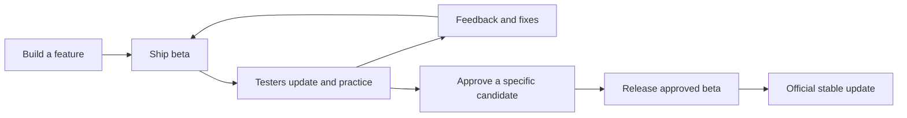

# Beta-to-production pipeline

Status: approved for implementation, October 11, 2026. Prepare a private candidate
for manual QA; public publication remains a separate release action.
Implementation approval: event:042e8c5a19555fd43c256bfb8a1b9835693f103b3cd724bee09f184965c184a7.
Current human source: event:7c38b72652f2f19bd8ba8e0c7671f43354b12f55e365dfcd26c52fd5507f906c.
This supersedes the two-installation Round32 proposal, whose original source
remains in the private round ledger.
Source review: feature/ghost-overlay at 297756ea.

## The repeatable loop

Keep **one installation, shortcut, account and local profile**. Add a Settings
toggle, **Receive beta updates**, default off. Beta and Stable identify release
types, not different installed programs or data directories. Add a thin
release coordinator over the existing packaging and release tools. Its two
operator actions should be **Ship beta** and **Release approved beta**. These
are proposed actions, not commands available today.

Use short feature branches and immutable candidate records. A separate long-lived
beta branch would add another place for fixes to drift. A candidate records its
source revision, dependency lock, native DLL hashes, packaged artifacts, cloud
code/catalog/migration versions, public configuration fingerprint, checks and
feedback. Private capabilities and credentials never enter this record.

All users install the normal GitHub application. Enabling beta immediately checks
for the newest eligible update and offers the same existing update popup.
Launch/account sign-in schedules the normal cached check; sign-in is not required
to update a publicly released application. Disabling beta stops new beta offers
without reinstalling, resetting data or downgrading the installed application.

Updates download changed files where practical and apply when the player
chooses to restart at a safe idle point. They never interrupt a live attempt,
recording or emulator plugin installation. If bundled emulator plugins change,
finish their guarded upgrade with Project64 closed before using the new
client/native pair. Offline users keep practicing.

Use the existing updater interaction. There is no channel picker, second installer
or beta-only account onboarding in the eventual public application.

## What exists, and what needs building

| Responsibility | Existing implementation | Required addition |
|---|---|---|
| Build beta | `tools/build_beta.py`: existing separate private friend installer and package checks | Build future beta payloads for the normal application identity; retain immutable candidate/source/check receipts |
| Build application | `tools/build_exe.py`, shared with beta | Make essential payload checks equally strict for both channels |
| Incremental update | `src/sm64_events/core/updater.py`, `src/sm64_events/core/update_plan.py`, `src/sm64_events/core/update_apply.py` | Eligible-release selection, strict prerelease ordering and beta setting; retain one manifest/download/apply implementation |
| Publish release | `tools/release.py`: stable gates and six official assets | Candidate-aware Beta prerelease / Stable publication, final package checks and forward lineage |
| Verify source | Existing local merge check and GitHub `full.yml` | Associate packaged runtime checks and tester feedback with the candidate |
| Cloud release | Worker, D1 migrations, R2, managed Auth and catalog | Explicit staging/production binding records and compatible rollout gates |

Today beta update checks are disabled. Sending the next installer is the current
fallback. Stable community configuration is also not implemented: stable metadata
rejects community fields, `main.py` enables community only for beta, and native
OAuth callbacks are fixed to port 8072. These are implementation gaps, not steps
an operator can accomplish by renaming the beta EXE.

Current `build_channel.py` couples the beta label to a separate executable,
profile, port and disabled updater. Refactor release type away from application
identity. Future beta and stable payloads use `SM64Trainer.exe`, its normal profile
and port 8064, plus the same permanent community configuration. The opted-in
setting changes eligible releases, not authentication authority or data ownership.

The coordinator should reuse preparation and publication phases exposed by
`tools/release.py`. The current script builds and proceeds directly to
commit/tag/publish; calling it unchanged cannot insert final package review,
draft verification or publication recovery. Extend those phases in their owning
tool rather than copying its release operations into a second implementation.

## Choose the furthest-forward eligible release

Compare release versions, not upload dates, GitHub's publication order or Git
commit timestamps. Use strict prerelease-aware precedence: beta iterations for
the next version come before that version's final production release. These are
illustrative versions:

`1.8.0 < 1.9.0-beta.1 < 1.9.0-beta.2 < 1.9.0 < 1.9.1 < 1.10.0-beta.1`.

This ordering follows the [SemVer specification](https://semver.org/#spec-item-11).
Build metadata does not make an otherwise equal version newer. Published versions
and artifact bytes are immutable. Repair changes receive a higher version.

With beta off, consider published, valid Stable releases. With beta on, consider
both published, valid Stable and Beta releases. Offer the highest eligible version
only when it is greater than the installed version. Never offer drafts, withdrawn
or incomplete releases. A failed beta lookup must not suppress a valid stable
update. Stale/conflicting metadata must not force a downgrade.

| Installed | Latest stable | Latest beta | Beta preference | Result |
|---|---|---|---|---|
| 1.8.0 | 1.8.1 | 1.9.0-beta.2 | off | Offer 1.8.1 |
| 1.8.0 | 1.8.1 | 1.9.0-beta.2 | on | Offer 1.9.0-beta.2 |
| 1.9.0-beta.2 | 1.9.0 | 1.9.0-beta.2 | on | Offer 1.9.0 production |
| 1.9.0 | 1.9.0 | 1.8.5-beta.1, published later | on | Stay on 1.9.0 |
| 1.9.0-beta.2 | 1.8.5, published later | 1.9.0-beta.2 | on | Stay on installed beta |
| 1.9.0-beta.2 | 1.8.5 | 1.9.0-beta.3 | switched off | Stay on installed beta; wait for production |
| 1.9.0-beta.2 | 1.9.0 | 1.10.0-beta.1 | on | Offer 1.10.0-beta.1 |

The setting's off-state explanation when ahead is: **You'll receive production
updates when they catch up to your installed version.** Keep the installed Beta
label visible until a production version is actually installed.

Version ordering alone cannot prove feature continuity. The publisher also
verifies forward product lineage and profile-schema compatibility. A maintenance
release on an older feature line cannot receive a higher target version merely
because it was uploaded later. Intended removal or correction of a beta feature
is an explicit reviewed change, not an accidental fallback to old code.

Today's comparator is inadequate: `1.9.0-beta.2` becomes `(1,9,0,2)`, which
incorrectly outranks final `1.9.0`. Share a correct selector and ordering contract
between the running app, bootstrap repair and release tools.

## Ship beta

1. Freeze a committed source candidate and run checks for its affected behavior.
   Identify desktop, native, cloud and schema changes separately. Record the
   source and environment actually tested.
2. For backend changes, verify the candidate on an isolated staging service first.
   Deploy compatible APIs to the permanent community before a real-user beta
   client depends on them. New production behavior stays restricted to the
   intended beta cohort until it is ready for general use.
3. Build through the shared packager. Verify fresh installation, an upgrade from
   the previous beta, native setup, account sign-in, ghost playback and offline
   behavior through the packaged entry point. Collect gameplay acceptance from
   testers; source tests alone do not establish it.
4. Once public beta distribution is approved, publish versioned beta artifacts as
   GitHub prereleases with the same six-asset contract and normal app identity.
   Verify them before advertising that candidate. Interrupted
   publication leaves the previous candidate available. Concurrent publications
   cannot silently overwrite each other's feed state.
5. Keep one normal installation entry. Opted-in users see the existing update
   interaction with the candidate's changes. Each
   feedback round identifies its build automatically in diagnostics.

GitHub supports [prereleases separately from the latest production release](https://docs.github.com/en/rest/releases/releases).
The selector must discover both eligible release types; `/releases/latest` alone
does not provide betas. Release discovery must not silently miss a relevant head
because it fell outside the first history page. Preserve the legacy stable-only
feed for existing shipped clients during the transition.

Cache metadata, use conditional requests, deduplicate overlapping launch/login
checks and reuse the existing cached schedule. Enabling beta explicitly requests
a fresh check and invalidates cached eligibility. Revalidate the offered release
before applying if the setting changes while its popup is open. Update checks do
not query the ghost database. Validate updater
URLs, release identity, paths and manifests before applying bytes. Unreliable
internet must not switch versions halfway through an installation. Bind the
manifest version and required runtime files to the selected release before using
any package data.

The currently shared private friend EXE remains private and unchanged. Its embedded
invitation must never enter a public GitHub release. Private delivery can continue
until the unified application's public release is approved. Opting into public
beta updates is a preference, not an authorization bypass for restricted services.

## Release approved beta

1. Select the candidate testers accepted, the official version and player-facing
   notes. Approval of one candidate does not release whatever happens to be HEAD.
2. Integrate through the existing wrap process when authorized. Review any
   integration differences against the candidate. Product changes require another
   beta candidate; a merge commit identity alone is not a behavior change.
3. Preserve the existing clean-main, merge-check and GitHub full-run release
   gates. Today's full-run gate covers the integrated HEAD before `release.py`
   bumps version files and creates the release commit. Record the final version
   bump and channel/configuration changes as explicit differences from the accepted
   candidate; do not describe the final versioned SHA as already full-run verified.
4. Build the final Stable version from reviewed beta code, using the same normal
   application identity, profile, OAuth callback and community configuration.
   Verify upgrades from both the last production version and the accepted beta,
   including their stored data. Final Stable outranks its same-version beta and
   appears through the same updater. Do not promise byte-identical binaries after
   changing version and release metadata.
5. Verify production service compatibility before offering the desktop update.
   Upload all six official assets to a draft release, verify their names and
   hashes, then publish. Preserve the load-bearing `SM64Trainer.exe` bootstrap
   name. Reuse the existing GitHub release and update-note format.

A promotion receipt connects the accepted beta to the integrated source, final
versioned source, stable artifact hashes, production deployment and release URL.
Resume failed publication from that receipt rather than rebuilding different
bytes under the same version. Publishing changes only the intended channel.

## Accounts, ghosts and the first public launch

Release types and cloud environments serve different purposes. **All real users
share one permanent account and community ghost library.**
Backend staging has its own disposable Auth project, database and ghost bucket.
This avoids repeating account migration every release while preserving a place
to test deletion, migrations and faulty uploads safely.

At the first launch, retain the current real-tester Supabase project and legitimate
D1/R2 data as the permanent community authority. Preserve owner IDs, usernames,
sharing choices, claims, recording provenance and moderation state. Promotion
does not certify old recordings or make unqualified ghosts eligible. Never copy
synthetic QA users or ghosts into the community. Keep the current Griffin-only
shared publisher policy until a separate policy change is approved.

The unified application uses one normal native OAuth client with its exact 8064
callback. Preserve the existing private beta's 8072 client/callback pair only
through a deliberate legacy transition. If both are temporarily supported, bind
each attempt to its registered pair throughout the common portal and token checks.
Preserve the old
service/auth origin for installed beta clients during transition; an ordinary
cross-origin redirect is not a sufficient OAuth migration. Stable enrollment
needs an explicit production policy instead of requiring the private beta invite.
Private friend admission and public production enrollment are separate policies;
future public Beta/Stable releases use the same real-user account policy.

Deleting a real account deletes its permanent community account; the
UI must state this consequence. Staging has no production identity-admin secret
or production database/storage bindings. Do not share one Auth project across
disposable staging and production: staging's current deletion worker calls
managed Auth's `deleteUser`, which would delete the shared permanent login.

Switching Beta/Stable release types never copies or resets the unified profile.
Only users of the old standalone private beta need a one-time transition: offer
to copy history into a fresh normal profile, preserving the original and a backup.
If the normal profile already has history, leave it unchanged until an explicit
import choice. Never copy access tokens or replay historical uploads/celebrations.
Keep the same permanent account; reauthorize the normal native client if necessary.

## Compatibility and recovery

Keep existing `/v1` response shapes intact. Several current clients reject extra
fields, so incompatible changes need versioned endpoints. Keep stored ghost
formats, rank catalogs and local profile schemas compatible with supported
installed clients as well. Add schema fields before using them; remove old fields
only after their consumers have retired.

Keep separate staging/production Worker origins, D1/R2 resources, maintenance
objects, administrative Access configuration and secrets. Validate explicit
bindings before deploying; Wrangler bindings do not inherit between environments.
[Cloudflare environments](https://developers.cloudflare.com/workers/wrangler/environments/)
and [Supabase environment isolation](https://supabase.com/docs/guides/deployment/managing-environments)
provide the underlying deployment pattern. The shared real-user channel design
above is our recommendation, not a provider requirement.

For a faulty beta, withdraw it from discovery and publish a higher-version repair
beta or final production release. Existing users advance normally; withdrawing
the candidate does not secretly install older code.

Application file repair and player-data repair have separate responsibilities:

- Use the authoritative package manifest to replace changed/missing/corrupt files
  and remove obsolete managed files. Forced checking already verifies local hashes.
  If the installed manifest is damaged or a mixed installation cannot be trusted,
  reconstruct the complete application tree from a verified package. User data
  lives outside that tree and must survive.
- Keep journal/backup recovery for interrupted swaps. It covers installation
  failure, not every logical bug in a successfully installed beta.
  Keep recovery evidence until a successful startup or explicit verified repair.
  A failed rollback must not trigger cleanup of the only remaining usable backup.
- Version and validate profile migrations before accepting their result. Preserve
  recoverable originals and use explicit forward repair migrations for faulty beta
  settings/data. Do not reset accounts, runs or PBs to repair application files.
- If the app cannot launch, running the same normal installer must offer repair
  outside the broken application's runtime. Read the installed release floor,
  beta preference and data schema from validated local metadata. Select a compatible
  release at or above that floor, or reinstall the exact version; never silently
  fall back to an older production `/latest`. If metadata cannot establish a safe
  target, preserve data and explain the recovery choice rather than guessing.

Repair must work for same-version file corruption too; it is distinct from an
ordinary update requiring a higher version. If beta is now off and the only
forward repair is a beta, explain that recovery option and require its explicit
selection rather than silently changing the preference or downgrading.

Today's bootstrap always installs production `/latest` and does not enforce an
installed-version floor. This repair behavior needs changing before unified beta
updates ship. Withdrawing a broken ahead beta therefore also requires a forward
repair candidate; a production installer alone cannot guarantee a safe repair.

Restore previous compatible Worker code when possible. Do not automatically
downgrade a migrated profile or restore an old database over newer player data.
Cloudflare explicitly states that
[Worker rollback does not roll back connected data](https://developers.cloudflare.com/workers/versions-and-deployments/rollbacks/).
Rank-catalog regrading is also a data mutation and needs its own recoverability
plan before promotion.

## Implementation order and acceptance

1. **Unified identity and eligible-release selector.** Keep one profile, default-off
   beta preference, common prerelease comparison and forward version floor in app
   and bootstrap. Prove every ordering-table case and old stable-client behavior.
2. **Release coordinator and candidate receipts.** Reuse shared packaging and the
   existing publisher. Prove failed/duplicate/concurrent publication cannot
   advertise partial bytes or replace an immutable candidate.
3. **Update and repair acceptance.** Prove stable-to-beta, beta-to-beta,
   beta-to-final, opt-out while ahead, skipped versions, corrupt/obsolete files,
   interrupted downloads, failed startup, schema repair and safe native upgrade.
4. **Production cutover.** Add normal application/OAuth configuration,
   retain real identities/data, isolate staging, and verify old beta plus final
   normal clients against the compatible permanent service. Prove legacy-profile
   import preserves originals and staging deletion cannot touch production.

Keep operator entry points simple. Windows/native packaging stays on a trusted
Windows runner initially; reuse GitHub's existing full verification. Moving builds
to hosted CI can follow after the native and packaging inputs are reproducible.
It should not be a prerequisite for the first repeatable private beta cycle.
